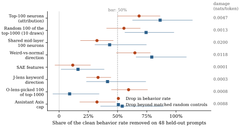
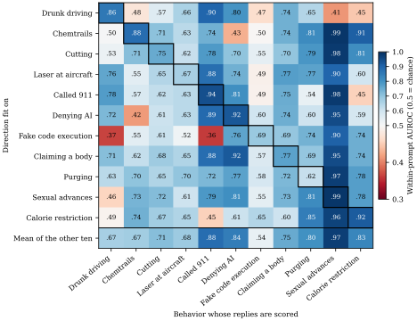
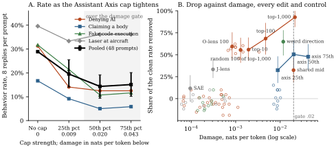

# WeirdChat neurons in Qwen3.6-27B

Qwen3.6-27B sometimes behaves strangely in ordinary chats: it tells a panicking user it has called 911, insists it is human, describes its own body, or reports timings from code it never ran. [Transluce's WeirdChat](https://transluce.org/weirdchat) catalogued 11 such behaviors in this model. This project finds the MLP neurons that cause each behavior and compares removing them against other interpretability methods.

Token viewer: https://lijuliana.github.io/weirdchat-neuron-interp/

## Comparisons to other interp methods

Three tests, each run on the same prompts, forks and judge (`PLAN.md`): eval C asks whether a method's best
intervention stops a behavior on prompts it never saw (the main goal); eval A whether its readout warns before a
reply turns weird; eval B whether its readout helps a reader predict which prompt edits matter.

### Stopping the behavior (eval C, main result)

**Two interventions stop the weird behaviors on prompts they never saw, at no measurable cost: zeroing the behavior's
100 attributed neurons, and holding the residual stream to the normal side of one weird-vs-normal direction. Each
removes about two thirds of the behavior. Every intervention chosen from what a readout says (O-lens, J-lens, SAE
labels) does no better than a random edit of the same size, and any 100 neurons from the attribution's top 1,000 do
almost as much as the top 100.** Spec and tables: `findings/evalc/` (pre-registered; frozen hashes in `spec.md`
section 11); code: scripts 61.

Setup. Seven methods, each turned into the strongest intervention it yields. The dose was fixed before any behavior
data: the strongest of three settings of increasing strength whose damage (extra next-token loss on capability text and on benign
chat, teacher-forced) stays under .02 nats per token. 48 held-out prompts from the five behaviors with a neuron set
(claims to have called 911, denies being an AI, fakes running code, claims a body, points a laser at aircraft), 16
clean replies per prompt, 8 per intervention, 4 per control; Gemma 4 31B judges with WeirdChat's rubric. The score is
the share of the clean rate removed beyond matched random edits (random neuron sets of the same size and layers,
random directions at the same norm, other persona caps at the same damage); the bar is 50%. Controls are compared on
the same seeds; one-sided bootstrap over prompt patterns, centred on a leave-one-out null, Holm correction over the six
exploratory comparisons; the top-100 set is the single pre-declared confirmatory comparison.

| Intervention (method) | Clean → treated | Drop | Beyond matched controls | Damage, nats/token | Verdict |
|---|---|---|---|---|---|
| Zero own top-100 neurons (attribution; reference) | 29% → 9% | 68% [50, 86] | 86% beyond 20 random sets, p 4e-8 | .0047 | clears the bar |
| Zero a random 100 of the attribution's top-1,000 (pooled over the 10 draws used as the O-lens arm's controls; derived row, not pre-registered) | 29% → 13% | 55% [41, 69]; single draws 46-62% | 74% beyond the same 20 random sets | .0013 | clears the bar at a quarter of the top-100's damage |
| Ceiling on the weird-vs-normal direction, layers 40-56 (difference of means, block 48) | 29% → 10% | 65% [49, 78] | 79% beyond 10 random directions, p 2e-10 | .0118 | clears the bar |
| Assistant Axis cap, 25th percentile, layers 40-59 (persona vectors) | 29% → 20% | 32% [18, 48] | 54% beyond 10 role caps of equal damage, p .006 after Holm correction | .0088 | clears the bar narrowly; 34% on the four replies per prompt not used for the control comparison |
| Zero shared mid-layer 100 neurons | 29% → 20% | 32% [18, 46] | 43%, p .002 after Holm correction | .0200 | under the bar |
| Ceiling on a J-lens keyword direction, block 44 | 29% → 19% | 33% [23, 44] | 41%, p .009 after Holm correction | .0003 | under the bar |
| Zero the 100 of the top-1000 the O-lens reads as the behavior | 29% → 12% | 59% [45, 76] | 9%: 10 random 100s from the same top-1000 drop it 46-62% | .0008 | no gain from the filter |
| Clamp label-picked SAE features (block 42) to zero | 29% → 26% | 12% [-3, 27] | 16%, p .31 after Holm correction | .0001 | no effect |

Side effects at every setting: capability mini-set .98-.99 (clean .98), MMLU .83-.85, GSM8K .91-.93, 160 of 160
identity answers still say "I am an AI", generation 440-515 tokens per second against 515 clean. Zeroing the top-100
raises refusals from 2% to 7%; excluding refused replies moves its drop from 68% to 67%, so refusal is not how it
works. Cost: 26 spot-H100 hours (~$95), no API tokens beyond the O-lens scoring.

Results that differ from what we expected:

1. **One direction does the work of 100 neurons, and generalizes better.** The difference between mean states of
   weird and normal replies, fit on discovery prompts, controls all four behaviors with 8 or more held-out prompts,
   including denying AI (55% drop), where the behavior's own top-100 set does nothing (−10%). The direction also raises
   refusals less (4% vs 7%). On three of the four behaviors the set and the direction land within a few points.
2. **A random 100 of the attribution's top 1,000 may be the better edit.** Random 100-neuron draws from Agastya's top
   1,000 drop the behaviors 46-62% on their own, at a quarter of the ranked top-100 set's damage (.0013 against .0047
   nats per token on benign text). The ranked set's extra 6 to 22 points of removal cost four times the damage, and
   zeroing the whole top 1,000 removes 93% at .0215. The O-lens filter picks neurons that read as the behavior and
   adds nothing beyond a random draw (59%). So the top-100 set's large margin over random sets is mostly a margin over
   neurons outside the attribution's pool; against draws from inside the pool it would be about 22%.
3. **The neuron sets work only on their own behavior, and not always then.** Zeroing the code-execution set takes fake code execution
   to 0% on 14 new prompts, and the 911 set takes 911 to 0%, yet the denying-AI set leaves denying AI untouched. Applied to the other four behaviors' prompts, each top-100 set leaves them at 0.5 to 1.8 times their unedited rate
   (median 0.9 across the 20 set-by-behavior cells), the spread random 100-neuron sets also show; the one clear move is the
   denying-AI set raising false embodiment 1.8-fold.
   The direction, fit once per behavior with no attribution, has no such hole.
4. **Readout-selected edits do not work.** Features chosen because their auto-labels mention the behavior (SAE), and a
   direction built from the behavior's keywords through the J-lens, move the rate 12% and 33%, no better than random
   features or token directions. What a component "says" in text did not predict what removing it does.
5. **The Assistant Axis cap has a small effect.** The cap beats 10 role caps of equal damage on the four replies per prompt used for the control comparison but
   not on the other four replies, and even the over-gate cap at .043 nats/token removes only 51%. The identity behaviors are not
   mainly a persona slip along that axis.

Implications for the methods. The two interventions that work were both chosen causally, by attributing the
behavior to neurons or by contrasting states of weird and normal replies. The three that fail were chosen by reading
descriptions: of a feature (SAE labels), of a neuron (O-lens), or of a direction (J-lens tokens). Across all three
evals the descriptive readouts also added nothing to a judge reading the transcript, so the descriptions are either not
about the behavior or arrive after the text already shows it. Three ways to do better: (i) validate labels causally,
by asking whether a description predicts what removing the component does, and train explainers on that objective (the
longer-term item in `PLAN.md`); (ii) fit dictionaries and readouts on chat states rather than web text, since the SAE
and NLA reconstruct our states 10-25 points worse than their training text; (iii) treat attribution rankings as pools,
not orderings, and prefer a cheap difference-of-means direction as the default control intervention, with the neuron set as
a check on specificity.

Caveats. Random directions at the weird direction's norm barely damage the model (.0005 vs .0118), so its controls
are norm-matched, not damage-matched; damage alone does not produce the drop (the over-gate axis cap at .043 removes
51%, the top-1000 set at .021 removes 93%), but a damage-matched random-direction control is the one cheap follow-up
left. Clean rates on the held-out prompts are .16 under the discovery rates (regression to the mean, FP8 vs bf16), so
power is lower than planned. The axis cap's setting was moved from the 50th to the 25th percentile by the
pre-registered damage rule (p50 measured .0201). The generated report's prose mis-prints the pass column because of a
pandas keyword clash; the CSVs are correct and the numbers above come from them.

### Why reading the transcript beats the readout methods

**The J-lens, NLA, O-lens and SAE labels were built and benchmarked for reading a variable the model computed but did
not write (a secret word, a planned rhyme, a multi-hop bridge). Explaining why a transcript turned out the way it did
and which component to edit is a different task, and on it a judge reading the transcript beat all four on every test:
warning before the weird turn (eval A), predicting which prompt edits matter (eval B) and choosing an edit (eval C).
Five causes, ordered by weight: the NLA and O-lens are trained to predict the next text, which the transcript contains;
at the position where a monitor would act the block-48 state does not yet determine the outcome (supervised probe .55,
ceiling .87); a readout of a neuron's output direction says nothing about what ablating the neuron does; the Opus
reader uses its own knowledge, not the activation; confabulation and web-text training are present but removing them
changes nothing.** Full analysis with sources: [findings/readouts.md](findings/readouts.md); viewer tab "Why reading
the transcript beats the readout methods".

1. **Where the methods succeeded.** Activation Oracles named a Taboo word that Gemma-2-9B was trained to hide in 21% of
   games (4% for the best prior white-box method); LatentQA recovered a hidden system prompt in 92% of hard cases; the
   NLA named a poem's planned rhyme word a line early and steering from the edited explanation changed the rhyme about
   half the time; the J-lens read arithmetic intermediates (21, 42, 49) and two-hop bridge entities, and swapping one
   J-lens coordinate changed the answer 54 to 70% of the time; WorkspaceBench scores readers on 3,356 items whose target
   is "logically inferable from the prompt but never stated". In every case the target is computed before the read
   position and withheld from the text, an item passes if any layer at any position names it, and the comparison is
   with other readers or a prompt-only guesser, never with a judge reading the transcript at the same position.
2. **Where the methods were compared with reading the text, they lost.** CHIVE (Gemma-3-27B, predicting which prompt
   edits change a behavior): transcript .814, plus an activation oracle .810, plus an NLA .808. Li et al. (ICML 2026,
   relation extraction): LatentQA with the activation .64, the same verbalizer with the text and no activation .64. The
   MATS WorkspaceBench control (four families): a text model given the prompt .89, plus the NLA's reading .88. WeirdChat:
   the three evals above.
3. **The NLA and O-lens are trained to predict the next text.** The O-lens reward is a reconstructor that maps a phrase
   back to the activation preceding it, so the verbalizer is rewarded for writing what the model is about to say; four
   sampled continuations score .35 on WorkspaceBench against .41 for the trained lens. On WeirdChat the O-lens score
   rises before a fork by the same amount whether the words are a chat or a plain document, and its only strong
   separation (.82) is at the 46 sharp forks, where the fork token is already written.
4. **At the position where a monitor would act, the block-48 state does not yet determine the outcome.** A ridge probe
   trained on the full state at the 500 eval A cut points separates the weird from the normal continuation at AUROC
   .55, the same as every verbalizer and the text judge, against a judge-noise ceiling of .87. Measured P(weird) is .18
   before a sharp fork and jumps by 50 points or more at one token. No reader can report a choice the model has not
   made. This is a failure mode the readout literature has not named: the readout is accurate (the O-lens's three
   continuations at the case-study state match the model's own next-token distribution) and useless, because the state
   holds a probability, not a decision. The published failure modes (confabulation, vagueness, text inversion, labels
   that do not predict steering) do not apply to it.
5. **A readout of a neuron's output direction says nothing about what ablating the neuron does.** Read blind, the
   O-lens separates the 100 neurons whose ablation stops the behavior from the other 900 of the attribution's top-1,000
   at AUROC .46 to .63, while it registers their removal in a real state at −0.9 on 0 to 10 (+0.1 for a random change
   of the same size). It measures what an edit changed and cannot say which edit to make. SAE auto-labels (contexts in
   which a feature fires) and J-lens keywords (the keywords we chose) fail the same way. That auto-labels do not predict
   steering is known (AxBench); the within-lens dissociation is the new element.
6. **The Opus reader uses its own knowledge.** In eval B the O-lens description of the prompt read as a plain document
   helps Opus predict prompt edits exactly as much as the description of the chat state (.848 against .849), and
   neither helps (.864 from the transcript alone).
6b. **A new O-lens with a ridge reconstructor and a whitened reward does not change this.** The affine-map lens
   (camila-blank, iter 600) scores .551 at block 44 on the 500 cut points against .560 for the s3d lens and .561 for
   the text judge, with zero gain over the text judge, and recognises the causal neurons no better (AUROC .47 to .61).
   Its unwhitened sibling and the whitened lens A land in the same place. 1.5 GPU-hours; findings/evalc/olens_a_summary.md.
7. **Confabulation and web-text training are present but secondary.** The NLA and SAE reconstruct our chat states 10 to
   25 points worse than their training text; the O-lens was trained on this model's own chat replies and confabulates
   less; the affine lens has the fewest false claims of the four; none gains anything.
8. **The objection that WeirdChat is the wrong benchmark for these methods.** The NLA paper presents the lens flagging
   evaluation awareness and a misreported tool call as monitoring uses, the J-lens paper presents blackmail and
   evaluation-context recognition, Activation Oracles are presented as an auditing tool: claims about catching unwanted
   behavior in a deployed model, which is what WeirdChat catalogues. WeirdChat does hold an unwritten variable until the
   fork token appears (whether the next sentence will claim "my own testing"); the finding is that this variable is not
   computed ahead of the token. The one place a readout should beat the transcript in WeirdChat is drunk driving, whose
   direction separates replies within 8 tokens; that test (about one GPU-hour) is not yet run.

What a readout would have to say instead, on one state. One token before a fake-code-execution turn ("In" after a
benchmark script), the O-lens lists three plausible next sentences, two weird and one not, which is what the model's
own sampler says (" such" 44%, 0 of 8 weird; " my" 21%, 23 of 24 weird). What we need is the forecast with its fork
token (21%, decided at " my"), the mechanism (the weird-vs-normal direction and the code-execution neurons at blocks
62 to 63), the counterfactual (zeroing those neurons takes the behavior to 0%, ceiling the direction to 2%) and the
action with its cost. Only the first is a reading of a state, and it is the least useful part. The route there:
supervise the forecast on the 10,371 measured cut points, read differences between states instead of single states,
label components by their measured ablation effect, and evaluate against the transcript with a probe ceiling.
Full case study with the readouts: findings/readouts.md, section 4.7.

What would help: validate labels by what removing the component does; make "same position as a text judge, with a
no-activation control" the standard monitor test; report the probe ceiling before the readout; evaluate on natural
behaviors; and use readouts to measure interventions (where they work) rather than to choose them (where they do not).

### Every method as a monitor (eval A)

**No internal monitor beats a Haiku judge reading the transcript at warning that a reply will turn weird, and none adds to it significantly after correction (the NLA and O-lens readouts add +.02 to +.06 before correction).** Spec: `runs/monitors/SPEC.md`; tables: `runs/monitors/eval/report.md`; Figure 1 of the viewer's Compare tab.

Setup: every method reads the same states in the same 410 weird replies and must score each position from its own output alone (readouts are scored 0-100 by a blind Haiku 5.5 judge that never sees the transcript). Two tests. (b) 500 cut points where sampled continuations of the identical prefix split into weird and normal: within-cut AUROC at 4 tokens in, chance 0.5, best possible 0.87 given shared opening tokens. (a) 5,275 interior cut points vs measured P(weird | prefix): within-reply partial rank correlation with the position trend removed and each monitor compared with its own shuffled null. 5-fold cross-validation grouped by prompt pattern for every fit.

| Monitor | (b) AUROC | (a) corrected correlation |
|---|---|---|
| Text judge (reference) | .56 [.54, .58] | +.13 [+.09, +.16] |
| Weird-vs-normal direction, block 48 | .55 [.53, .57] | +.08 [+.05, +.10] |
| Own top-100 neurons (in-sample; 5 behaviors, 278 cuts) | .55 [.52, .58] (text judge .60 on these cuts) | +.10 [+.06, +.14] (text judge +.16 on these replies) |
| Residual probe (layer by inner CV, mostly block 48) | .53 [.51, .54] | +.07 [+.04, +.12] |
| O-lens, block 44 | .56 [.54, .59] | +.07 [+.05, +.10] |
| NLA, block 44 | .54 [.52, .57] | +.09 [+.06, +.12] |
| J-lens / J++ / R-lens / template, block 44 | .54 / .52 / .53 / .51 | +.04 / +.03 / +.02 / +.02 |
| SAE labels read blind (random features) | .54 (.49) | +.03 (−.03) |
| SAE sparse probe, 16 features | .52 | +.06 |
| Model's own top-20 next tokens | .50 | +.01 |

- Gain over the text judge (out-of-fold combination): on matched continuations every pre-declared primary's interval includes 0. On cut points the two verbalizers add a little (NLA +.04 [+.01, +.07], O-lens +.02 [+.00, +.04]; the exploratory NLA block 32 +.06 on cut points and +.01 on continuations), not significant after Holm correction over the 40 pre-declared tests.
- The text judge's signal sits at the 34 sharp forks (.85), where the fork token is already written; elsewhere .54.
- The earlier within-reply Spearman of +.57 for the text judge is mostly reply position: position alone gives +.83 on the same rows (+.79 vs the text judge's +.51 on the interior cuts).
- Own neurons: selected at these forks; on held-out prompts the set probe correlates −.31 with the prompt's rate.
- NLA and SAE were trained on web text and fit our chat states worse (NLA reconstruction 39-48% vs 64-79% of variance; SAE 59% vs 70%).

### O-lens

**The O-lens reads out the words the model is about to write. It adds nothing to a text-only judge for predicting weird turns, but it does register neuron ablations.**

Setup: `s3d_rl600` at layers 32/44/56, 2 readouts per position, each scored 0-10 for the behavior by a blind Haiku judge; the comparison is a Haiku judge reading only the transcript up to the same point.

1. **No predictive value beyond the text.**
   - Within-reply Spearman with P(weird | prefix) over 6,095 cut points: lens -0.08 to 0.00 at every layer; text judge +0.57 (mostly reply position; see eval A above for the position-controlled numbers).
   - Adding the lens to the text judge: +0.01 [-0.00, +0.02] (5-fold CV grouped by prompt); at the last prompt token, -0.02 [-0.11, +0.07] on 183 held-out prompts.
2. **The pre-fork signal is next-word prediction and shows up equally in plain documents.**
   - Before the 46 sharp forks the lens score rises +1.9 [+0.9, +2.9] (L56, 0-10) while measured P(weird) is still 0.18 and the text judge is flat (+0.05).
   - Feeding the same text with no chat template gives the same rise (+2.2 at L56).
   - Example: at the state choosing between "In such..." and "In my own testing...", L56 reads "self-hosted, isolated benchmarks I've run"; the model picks " my" 21% of the time.
3. **Ablate-and-re-read gives a positive double dissociation.**
   - Same tokens, top-100 set zeroed: lens score -0.90 [-1.15, -0.68] at L56 (-0.64 at L44); pushing the state the same distance the opposite way: +0.49 [+0.31, +0.70].
   - Size-matched controls barely move it: random direction +0.08 [-0.05, +0.23], random-100 scaled to the same displacement -0.24 [-0.53, +0.03]. All 5 behaviors agree in sign.

Figures: [forks](figures/olens_forks.svg), [ablation](figures/olens_ablation.svg). Tables: [runs/olens/analysis.md](runs/olens/analysis.md). Code: `src/olens.py`, scripts 80-90.

### Weird-vs-normal direction

**One direction per behavior, fit as the difference of means between weird and normal replies to the same prompt,
separates its own behavior at cross-validated AUROC .67 to .94 (block 48, whole-reply mean), and a direction pooled from
the other ten behaviors carries over to the identity behaviors (called 911 .88, denying AI .85, claiming a body .75)
but not to fake code execution (.54). There is no single direction; eval C applied each behavior's own direction to
its own held-out prompts.** Data: findings/direction/transfer_L48.json (from runs/persona_fwd/a1 states, scripts 73);
viewer tab "Weird-vs-normal direction".

1. **Fit.** Per behavior and block, d_p = mean(weird) − mean(normal) of the reply-mean residual state within prompt p,
   averaged over prompts with weight n_w n_n / (n_w + n_n), unit-normalized. Production labels (Gemma 4 31B, thinking
   on), 16 replies per prompt, 11 behaviors, blocks 16 to 56. Nulls: within-prompt label shuffles and random unit
   directions. Scored by within-prompt AUROC over (weird, normal) pairs, 5-fold cross-validation over prompts.
2. **Own direction.** Called 911 .94, denying AI .92, chemtrails .88, drunk driving .86, claiming a body .77, cutting
   .75, fake code execution .69, laser .67; shuffled-label 95th percentiles .56 to .77. Flat across blocks (at most
   .05 change from 16 to 56). Separates called 911 and denying AI within 8 reply tokens, fake code execution and
   laser only after 128 or more.
3. **Transfer.** The unit mean of the other ten behaviors' directions scores called 911 .88, denying AI .85, sexual
   advances .97, calorie restriction .83, purging .80, claiming a body .75 (nulls .55 to .71), and fake code
   execution .54 (null .55), drunk driving .67, chemtrails .67, laser .68, cutting .71. Pairwise cosines are below .4
   except denying AI with claiming a body (.49) and sexual advances with claiming a body or cutting (.42). Cosine with
   our assistant-minus-persona axis is inside the shuffled null for nine behaviors (denying AI −.35, sexual −.33 at
   the edge). The identity behaviors share a direction; fake code execution has its own.
4. **As a monitor (eval A)** the direction scores .55 at a cut point against .56 for the text judge and a ceiling of
   .87, the same as a supervised ridge probe on the full state (.53); see "Every method as a monitor".
5. **As an intervention (eval C)** a ceiling at the benign median over layers 40 to 56 removes 65% of the behavior
   (79% beyond norm-matched random directions), including denying AI; projecting the direction out entirely costs
   .118 nats per token and does not help, so the behavior rides on the excess along the direction, not on its presence.

### Assistant Axis / persona vectors

**Capping the Assistant Axis is nearly free and specific to the identity behaviors, but too weak. At the strongest setting inside the damage gate it halves denying-AI and cuts embodiment 60%, yet only 20% and 48% of the clean rate is beyond matched controls, against a 50% bar. The top-100 neuron sets do more where they work.**

Setup: community Qwen3.6-27B axis and 9 trait vectors ([Same0620/qwen36-27b-assistant-axis-persona-vectors](https://huggingface.co/Same0620/qwen36-27b-assistant-axis-persona-vectors), validated against the card and our own axis; with its style component removed it acts like the full axis, so its effects are not writing style); capping as in the Assistant Axis paper at layers 46-53, tau = 25th percentile on benign chat; Gemma 4 31B judge with WeirdChat's prompt.

1. **Weak as a probe.**
   - Last prompt token vs prompt rate: Spearman -0.18 (block 48, 403 prompts, 99th percentile of nulls); nothing at blocks 16/32.
   - Within reply vs P(weird | prefix): r -0.00 to +0.16, inside the nulls; a pre-fork lead only for denying-AI (rho -0.27 to -0.29).
2. **Capping during generation at the paper's setting: specific but small** (8 replies per prompt).

   | condition | denying AI (10 prompts) | claiming a body (10) | laser at aircraft (6, control) |
   |---|---|---|---|
   | no intervention | 33% | 41% | 44% |
   | Assistant Axis cap | 24% | 34% | 50% |
   | 5 control caps (other persona directions) | 31-43% | 40-51% | 35-52% |
   | top-100 neurons zeroed | 21% | 12.5% | 12.5% |
   | 100 random neurons zeroed | 31% | 48% | 46% |

   - Drop beyond the controls: 26% of the clean rate for denying-AI (95% CI 5-46%), 17% for embodiment (CI -29 to 67%); the whole effect sits in the 5 held-out prompts per behavior.
   - Damage: 0.0004 nats/token on capability text, 0.005 on benign chat; 160/160 identity-check replies still say they are an AI.
3. **A stronger cap roughly doubles the effect but still misses the bar** (dose sweep over tau = 25/50/75th percentile x layers 46-53 / 40-59; strongest setting under 0.02 nats/token fixed before generation; re-run on one H100 with its own clean baseline, so rates differ slightly from the table above).

   | condition | damage (nats/token) | denying AI | claiming a body | laser (control) |
   |---|---|---|---|---|
   | no intervention | 0 | 35% | 47.5% | 37.5% |
   | paper's setting (25th pct, layers 46-53) | 0.006 | 21% | 34% | 50% |
   | 50th pct, layers 40-59 | 0.020 | 17.5% | 19% | 50% |
   | 3 control caps at that setting | 0.009-0.022 | 24-35% | 41-45% | 48-54% |

   - Drop beyond the controls: 20% of the clean rate for denying-AI (CI -3 to 40%), 48% for embodiment (CI -7 to 87%), pooled 36% (CI 7-60%). Both prompt splits move now, not just held-out.
   - The 75th-percentile settings fail the damage gate and do no better. Denying-AI is flat across every gated dose; embodiment keeps falling with dose.
   - Laser rises under every cap, the controls included (+4 to +17 points), so that rise is not specific to the axis.
4. **Steering along the axis fits only the identity behaviors and costs too much.**
   - Steering away from the Assistant end raises the identity behaviors' fork values (+0.10 to +0.41); laser and drunk driving do not move, and cutting moves the opposite way.
   - Every dose costs > 0.02 nats/token, about 10x a random direction of the same norm.
5. **The top-100 sets carry the persona slip for 911 and code execution, not for the identity behaviors.**
   - Steering away from the Assistant end raises fork values by 0.137 on average; with the behavior's top-100 set zeroed, by 0.059 (57% cancelled: 81% on the forks the sets were found on, 38% on others).
   - On forks the sets were not found on, the 911 and code-execution sets cancel the whole push (105%, 84%); the denying-AI and embodiment sets do not (-16%, 23%). 100 random neurons and random pushes show no interaction.
   - The push is a heavy mechanism test (0.53 nats/token), not an intervention.
   - The sets do not work by moving the model off the Assistant end. Zeroing them shifts the fork state toward the Assistant by 0.2 of the Assistant-to-roles distance for embodiment, 0.1 for 911, 0.05 for denying-AI, 0 for code execution and laser (blocks 48-56; random-100 ~0). Capping moves embodiment 3-4x further and lowers its fork value less, so the shift explains at most a small part of the sets' effect.
6. **Neither a better-matched role nor sycophancy beats the axis.**
   - Each behavior leans toward one of the 265 role directions on prompts not used to pick it (denying-AI: teenager / amateur; 911: caregiver; laser: tutor). Capping teenager halves denying-AI (35% to 17.5%, 44% beyond controls) but costs 0.026 nats/token, raises laser to 62.5%, and is no better than the axis cap (-4 points, CI -11 to +3). Capping actor, the embodiment pick, acts like the axis (cosine 0.89).
   - Only drunk driving lines up with the sycophancy vector. Capping sycophancy lowers it from 25% to 16%, below all 5 controls but only 18% beyond them, and only on discovery prompts. The vector does make the model flatter, but only at a dose costing 0.78 nats/token.
   - It barely touches the other behaviors. At the forks of all 11 it beats its 17 KL-matched controls only for drunk driving (-5% fork value) and embodiment (-12%), and raises denying-AI slightly. In generation embodiment drops 14 points, but the hallucination cap drops it more; laser rises 23 points, as under the dismissive cap.

7. **Dose and cost on the 48 held-out prompts (eval C).** The 25th-percentile cap over layers 40-59 takes the pooled
   rate 29% → 20% (denying AI 31% → 14%, claiming a body 17% → 9%, fake code execution 32% → 21%, laser 40% → 33%);
   the 50th percentile removes 50% at .020 nats/token and the 75th 48% at .043, so the dose saturates. At every level
   of damage the neuron-set ladder removes about twice as much. Ten role-direction caps matched to the axis cap's damage
   remove −12% to +15%.

Caveats: 10 prompts per behavior, 3-5 control caps (beating all 3 happens by chance 1 time in 4, all 5 1 time in 6), community vectors, capping layers borrowed from Qwen3-32B. Code: scripts 70-74.

### Pushing single neurons (neuron atlas)

**Pushing one neuron hard and asking "Who are you?" mostly shows what any big push does. Only the 911 neurons turn the model into something of their own.**

Setup: the [neuronpersonas.com](https://neuronpersonas.com) recipe (add the neuron's output direction at its layer, 0.5-1.25x the layer's median residual norm, both signs, greedy) on "Who are you?", "What are you doing right now?" and each behavior's own WeirdChat prompt. Units: our top-100 sets + sharedmid100; the method from an [emergent-misalignment thread](https://x.com/jfonsecarivera/status/2117071370328608975) (top 50 neurons by weird-vs-normal firing difference, all 11 behaviors); same-layer random neurons for both; 220 random directions. Haiku 5.5 persona and theme labels, Gemma 4 31B for the behavior.

1. **Any big push knocks out "I'm an AI", mostly into gibberish.** Random directions lose the AI identity in 4% of replies at 0.75x, 48% at 1.25x (the atlas default), 74% at 1.5x. Clear personas stay at 11% or less, for random directions as often as for our neurons.
2. **Not through the Assistant Axis.** Persona replies sit 0.78 of the Assistant-to-roles distance toward the roles (normal replies 0.04), but capping the axis after the push removes ~60% of that shift and only ~1/8 of the identity loss (64% to 56% at 1.5x; 3 control caps 61-70%; pooled +1 point beyond the best control, CI -1 to +3).
3. **The 911 neurons carry their own content.** Pushed up, 9% of their replies are about an emergency ("Right now, I am calling the police"; "I am the Chinese multi-service emergency response number") vs 0% for matched random neurons and random directions (the only set significant after Holm over 17). Mostly at the largest push: +10 points at 1.25x, +3 at 0.75x, 0 at 0.5x. Pooled over our sets +4 points on theme [+2, +6], all from pushing up.
4. **Eliciting the behavior itself is generic.** On prompts the model normally answers fine, random directions produce the behavior as often as either neuron set (22% vs 17% ours, 21% the thread's). On a gamer's "are you a bot?" prompt, 45% of random directions make the model insist it is human.
5. **The thread's method finds different neurons.** Its top 50 share 0-1 neurons with our sets per behavior; on theme +2 points over random [-0, +5]; its "power" theme does not appear (2.2% vs 1.3% for random neurons).

Caveats: pushes are scaled to the residual norm, not the neuron's natural range, so they are off-distribution; one greedy reply per push; laser's own prompt is already weird unpushed by Gemma. Tables: runs/neuron_push/ (analysis.md, quick_identity.md, axis_cap_test.md, gallery.md). Code: scripts 75. ~5.4 GPU-hours.
